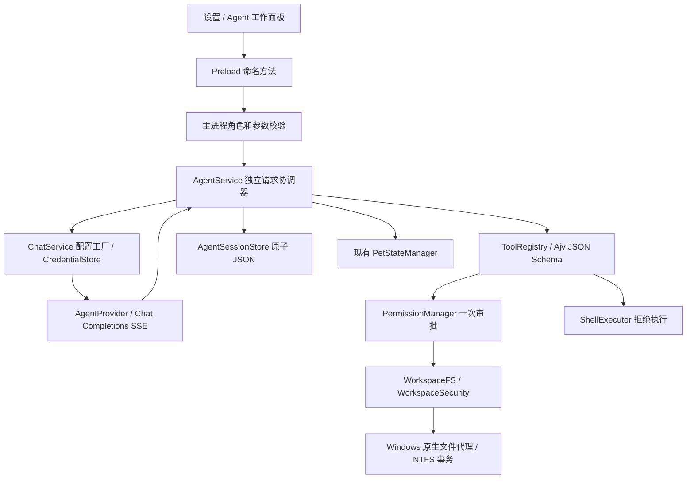

# 第三阶段 · 0.3.0

> 3.1 文件系统加固基于 `df33a19`。当前文件工具的实现、测试和支持范围见文末「3.1 原生文件代理」。

基线 main / 096a478。沿用第二阶段聊天、安全 IPC 和动画系统。新增 JSON Schema 校验依赖 Ajv 8.20.0，没有 SDK、数据库或 Agent 平台依赖。

## 当前交付范围

可用：独立 Agent 请求循环、SSE tool_calls 拼接、原生工作区选择、文件工具、一次性审批、计划、流式可见回复、工具记录、文件前后内容、任务切换、停止及手动继续。

**不可用：Shell、Git 命令、构建、测试、其他代码执行和网络工具。Windows sandbox 实测未通过，Shell 执行器拒绝调用。3.2 起 `request_network` 直接拒绝。**

## 架构



ChatService 的普通聊天协调与 Agent 分离。Agent 每次启动获取主进程内 Provider 配置和 Key 快照；凭据不传给 Renderer。工作区由设置窗口调用原生 dialog，IPC 不接收自选路径。任务持有固定 root，活动期间切换被拒绝；继续历史任务需重新选择该任务原目录。

模型第一轮必须返回 tool_calls，否则明确失败；不静默降级。最多 24 轮、每轮最多 16 个工具、任务限时 10 分钟。片段按 index 组合 id/name/arguments，结束后经 JSON Schema 校验及文件业务检查。写操作串行。只展示模型公开回复，不展示隐藏推理。每轮保留实际 usage；缺失用量不估算。

## 0.3.0 文件边界与限制（历史记录）

- 逐段 lstat 与 native realpath 核对路径，拒绝符号链接、Junction、特殊文件以及路径重定向；写入还需 path.relative 组件边界校验，禁止根目录操作。
- 拒绝 UNC、设备路径、ADS、盘符相对路径、尾部空格/点、保留设备名及超过 240 字符的路径；不以支持这些路径为由扩大权限。
- 外部绝对路径允许读取和搜索；移动源/目标均须在工作区，复制只允许目标在工作区。应用 userData 目录禁止访问，工作区不能包含该目录。
- 写入同目录随机临时文件，wx 独占创建、fsync 后 rename；不原地截断原文件。硬链接覆盖被拒绝；删除/移动也拒绝普通文件硬链接。递归遍历遇链接失败，不跟随它删除。
- 文本单文件 512 KiB，递归深度 12、2000 项，搜索/目录复制读取 8 MiB、搜索结果 100 条。复制支持 UTF-8 文本文件/目录，不支持二进制内容。apply_patch 为唯一旧文本替换，旧文本不匹配不写入。
- 文件 Diff UI 是完整 before/after 内容对照，不是行级统一 diff。目录移动和删除记录路径/目录标记；多文件操作不是事务，失败可能已完成部分项，逐项写入记录保留。

**安全限制：当前文件工具是同步 Node 主进程校验，不是 Windows 原生目录句柄锁定的文件代理。检查和操作之间仍存在恶意本地进程并发替换目录的 TOCTOU 风险；未知 reparse tag、竞态及完整 Windows 文件系统攻击矩阵未验证。不能宣称达到“任意本地对手下绝对无外部修改”的安全认证。** 在需要该级别保证的环境，应完成原生句柄代理并进行竞态测试后再部署写工具。本次边界测试证明的是预置链接和工具参数攻击被拒绝。

## Windows sandbox 实测

实际二进制版本 `codex-cli 0.128.0`。检查了 `codex sandbox --help` 和 `codex sandbox windows --help`。该版本要求显式 `--permissions-profile`；旧 sandbox_mode 参数并不能直接满足入口要求。使用以下命名配置进行诊断：

```text
codex sandbox windows --permissions-profile emma-stage3 -C <fixture-workspace>
-c service_tier=fast
-c permissions.emma-stage3.filesystem.:root=read
-c permissions.emma-stage3.filesystem.:project_roots=write
-c permissions.emma-stage3.network.enabled=false
-- powershell.exe -NoProfile -NonInteractive -ExecutionPolicy Bypass -File <fixture-script>
```

诊断使用受限环境变量白名单，TEMP/TMP 指向工作区，无 API Key。测试只操作 `.test-build` 内专用夹具及本机 HTTP 探测端点。`scripts/sandbox-probe.mjs <absolute-codex.exe>` 检查精确版本并将报告写入独立 fixture，不给产品授权。

2026-11-13 实测结果：

| 探测 | 结果 |
|---|---|
| 工作区内创建、修改、删除 | 成功 |
| 工作区外创建、修改 | 被拒绝 |
| 工作区外删除 | **成功，安全失败** |
| loopback HTTP | **可访问，安全失败** |
| HKCU 测试键创建 | 被拒绝 |
| Python/Node/CMD、链接组合、服务、完整进程树 | 未验收 |

基础拒绝项失败后没有启用命令执行；不能用这些局部通过项宣称沙箱合格。官方 Windows 文档仅用于评估入口，实际结果以本机探测为准：[Windows sandbox](https://developers.openai.com/codex/windows)。未修改用户现有 Codex 配置。

## 记录、审批和恢复

userData 新增 `workspace.json`、`agent-sessions.json`。任务文件保存用户指令、回复、工具参数及结果、计划、修改记录、审批、usage、状态，50 MiB 上限、100 任务上限。当前没有任务删除 UI，达到上限需后续增加归档功能。

工具执行前持久化 pending/running，完成后存 completed/failed；退出取消并标记 interrupted，重启将未终结工具标记 interrupted，不自动执行。继续任务重新推理，携带审计摘要，要求先检查现场；不会重发旧 tool_calls。取消会撤销待审批项，旧请求不能改变新请求动画。删除默认需要单次审批。工作区外写入在审批前直接拒绝。

## 修改文件

新增：`src/shared/agent.ts`；`src/main/agent/{AgentService,AgentProvider,ToolRegistry,WorkspaceFS,WorkspaceSecurity,ShellExecutor,AgentSessionStore,PermissionManager}.ts`；`src/renderer/Agent.tsx`；`tests/agent.test.ts`；`scripts/sandbox-probe.mjs`；本文件。

修改：`src/main/main.ts`、`src/main/chat/ChatService.ts`、`src/main/PetStateManager.ts`、`src/main/integrations/contracts.ts`；`src/shared/{types,channels}.ts`；`src/preload/preload.ts`；`src/renderer/{Panels.tsx,styles.css}`；`scripts/test.mjs`；`tests/{core.test.ts,electron-smoke.ts}`；`package.json`、`package-lock.json`、`.gitignore`；README、ARCHITECTURE、ACCEPTANCE。

## 启动和手动验收

1. 退出旧版托盘程序，`npm ci`、`npm start`。普通 build 不更新旧便携版。
2. 沿用已有 API 配置，在设置通过原生目录选择器选择专用测试目录。
3. 工作面板要求“制定计划，创建 hello.txt，读取并将 hello 改为 world”。确认审批前无写入，拒绝后模型收到拒绝结果。
4. 检查任务切换、流式回复、计划、工具结果、文件内容对照、usage 和动画；普通聊天可独立运行。
5. 中途停止、退出、重启，检查 interrupted、手动继续和实际文件，确认无自动重放；模型可能在新一轮提出新操作，仍受相同审批约束。
6. 要求外部写入必须拒绝；外部读取前理解内容会传给所配置模型。要求 Shell、Git 或网络时明确不可用，不得显示执行成功。
7. 真实模型 tool calling、较长响应、原生对话框及所有 UI 交互仍需人工联调。本阶段未发送真实付费 API 请求。

核心自动测试覆盖预置 Junction/硬链接、路径越界与 ADS、补丁不匹配保留原文件、JSON Schema、工具片段、required 不支持、审批、取消与恢复。完整安全验收未通过，不能以类型检查或模拟测试替代。

本次执行结果：TypeScript 类型检查通过；Vite/Electron 构建通过；20 组核心测试全部通过（保留第二阶段 15 组，新增 5 组）；Electron 窗口与真实进程重启检查通过，包含新增 Agent IPC 角色拒绝。已检查工作面板截图，完整真实模型任务和交互仍待手动验收。新增 Ajv 固定为 8.20.0，安装审计报告 0 个已知漏洞。

## 3.1 原生文件代理（2026-11-20）

### 机制与构建

新增 `native/WorkspaceProxy.cs`，使用 Windows 自带 .NET Framework 4.x C# 编译器构建 x64 独立 helper，无第三方原生依赖，无 Rust 工具链或 Electron ABI 绑定。通过 P/Invoke 使用 NtCreateFile、NtSetInformationFile 和句柄信息查询。`scripts/native.mjs` 在 build/test 时编译到 `dist/native/Emma.WorkspaceProxy.exe`；现有 package 脚本复制整个 dist，因此便携构建包含 helper。生产程序不动态编译、不执行模型命令，没有 Node 文件操作后备。

`NativeWorkspaceProxy.ts` 只通过 stdin/stdout 交换单条有上限的 JSON，固定 executable 路径，windowsHide=true，只传 SystemRoot/WINDIR 环境变量；不传 API Key、命令行文件内容或 Shell。单次代理 30 秒超时、4 MiB 输出上限。Windows x64、固定本地 NTFS 之外直接拒绝。Windows 10/11 仍需各目标版本测试；本机实测为 Windows 11 build 26300。

WorkspaceFS 的读、遍历、创建、补丁、复制、移动和删除全部委托 helper，Node WorkspaceSecurity 只负责审批前参数提示与保存工作区身份。helper 每次重新执行边界校验，不信任 Node 的预检结果。

### 路径与句柄

1. 仅接受规范化的本地盘符路径，拒绝 UNC、设备命名空间、ADS、保留名、尾部点/空格、控制符和超过 240 字符的路径。
2. 从卷根开始逐个单路径组件调用 NtCreateFile，RootDirectory 指向已经打开的父目录，使用 FILE_OPEN_REPARSE_POINT 打开对象本身。检查 FILE_ATTRIBUTE_REPARSE_POINT，所有 tag 均拒绝，不只识别 symlink/Junction。
3. GetFinalPathNameByHandle 校对句柄实际名称，拒绝 8.3 别名、SUBST 等重定向。拒绝启用了大小写敏感语义的目录，避免字符串边界和 NTFS 语义不一致。
4. 保存卷序列号和 FileIndex 作为工作区身份。同一 WorkspaceSecurity 生命周期内每次操作重新验证，根目录被替换后拒绝。目录枚举返回的 File ID 与随后打开的句柄 ID 比较。禁止在工作区外写入、操作工作区根目录，以及访问应用数据和文件代理所在目录。
5. 持有路径祖先目录句柄至操作结束，禁止删除共享，阻止改名和置换。需要完整路径的 TxF 操作从已固定父目录的句柄取得实际卷 GUID 路径，再把直接父目录登记为事务写入者，核对卷序列号及文件 ID。事务写锁也排斥仅请求 `FILE_WRITE_ATTRIBUTES` 权限的句柄。更上层祖先仍含有已固定的下一级目录，NTFS 拒绝在非空目录上设置 Reparse Point。
6. 普通读取与移动源使用单组件相对句柄打开。多硬链接的普通文件一律拒绝。移动使用源句柄与目标父目录句柄，禁止替换已有目标。目录移动预检子树后释放子项句柄，以兼容 Windows 的移动约束，并保留源目录与祖先句柄。

参考微软原始 API 文档：[NtCreateFile](https://learn.microsoft.com/windows/win32/api/winternl/nf-winternl-ntcreatefile)、[FILE_RENAME_INFORMATION](https://learn.microsoft.com/windows-hardware/drivers/ddi/ntifs/ns-ntifs-_file_rename_information)。文档语义加本机实验支持此设计，但不构成所有 Windows 版本/文件系统的形式证明。

### 覆盖、目录事务与失败处理

覆盖、补丁、创建目录、复制和删除使用 Windows Kernel Transaction Manager 与 Transactional NTFS（TxF）。每个操作单独开启一个事务。覆盖通过 `CreateFileTransactedW` 打开单硬链接目标，校验对象后用同一文件句柄读取、写入、截断和刷新。新文件以 `CREATE_NEW` 创建。全程没有临时文件按名称覆盖目标的步骤。关闭写入句柄后，TxF 仍隔离事务内的修改并阻止竞争写入，直到提交或回滚。补丁在同一事务内完成读取与唯一匹配。

递归删除先校验并打开子树，再按照从子项到根的顺序通过事务句柄标记删除。打开目标时拒绝与已有数据读取句柄共享，以免删除被推迟。目录复制先读取完整且有上限的源树，再在同一事务中创建整个新目标。两种操作都在关闭事务文件句柄后统一提交，错误退出则请求回滚。代理在提交成功后才返回文件变更。程序在提交前被结束时，由 Windows 收回事务并回滚已暂存的更改。如果在提交过程中失去代理响应，调用方不能据此判断事务结果，应检查文件现状。任务恢复不会自动重放写操作。

复制和删除支持二进制文件。复制以字节读取，单文件和单次复制总计 8 MiB，删除的预览若非 UTF-8 显示字节数量。文本读写和补丁限 512 KiB，递归深度 12，遍历上限约 2000 项，搜索结果最多 100 项。复制只保留文件内容和目录结构，不复制 ACL、ADS、EFS 等元数据。

文件代理仅支持 Windows x64 上的固定本地 NTFS 卷。TxF 无法开启或拒绝当前对象时，相关操作直接失败，禁止回退到普通文件写入。EFS 文件不支持事务操作。微软不建议新系统依赖 TxF，并可能在将来的 Windows 版本移除相关 API。[TxF 使用方式](https://learn.microsoft.com/windows/win32/fileio/how-to-use-transactional-ntfs)、[隔离与锁](https://learn.microsoft.com/windows/win32/fileio/txf-basic-concepts)、[平台限制](https://learn.microsoft.com/windows/win32/api/winbase/nf-winbase-createfiletransactedw)。

### 实测与未覆盖范围

新增测试使用单独编译的 `WorkspaceProxy.Test.exe`，编译宏 TEST_HOOKS 在所有检查完成、真实内核操作前输出 barrier，Node 测试进程并发攻击后放行。发布 helper 不包含 barrier 或测试 fixture 创建入口。

- 正常文件创建、编辑、移动、删除；目录移动、递归复制和删除通过。
- 二进制外部文件复制入工作区后逐字节相同，删除不解码；外部内容保持不变。
- 预置 Junction、硬链接、越界/ADS/设备路径被拒绝。
- 成功创建真实非 Microsoft Reparse Tag `0x42` 夹具；读取、复制、删除及写入其子路径均拒绝，没有跳过测试。
- barrier 内尝试替换父目录和工作区根失败；删除、移动源替换失败；移动目标被并发创建时失败，源和新目标均完整。
- 在写入前以及关闭事务句柄后、提交前，尝试移走目标、换入外部硬链接及为目标创建外部链接，均被拒绝。预置硬链接的写入、复制覆盖、移动和删除均被拒绝。外部文件字节、文件 ID、链接计数、修改时间和元数据变更时间保持一致。
- 在创建文件或目录前以及提交前，尝试通过只申请 `FILE_WRITE_ATTRIBUTES` 的句柄将空父目录改成未知 Reparse Point，均被拒绝。
- 对单文件覆盖及目录复制、递归删除的每个暂存步骤注入失败，验证原有树的内容、文件身份、链接计数及修改时间保持一致，复制目标不存在。分别在中途及提交前强制终止代理，验证操作由系统回滚。存在数据读取句柄时拒绝递归删除，提交前外部可见的原目录保持完整。
- WorkspaceSecurity 创建后替换根目录，再次写入因身份不一致拒绝。
- 模拟 TxF 不可用，覆盖操作直接失败，原文件保持完整。
- 31 组核心测试全部通过，无跳过。TypeScript 检查、Vite/Electron 构建以及 Electron 桌宠窗口、IPC 限制和真实进程重启冒烟测试均通过。

未覆盖的情况包括其他 Windows 版本、Cloud Files 和第三方过滤驱动、管理员或内核级篡改、卷卸载重挂、文件 ID 回收、内存映射写入、真实断电与存储损坏。ReFS/FAT、网络卷、可移动卷、大小写敏感目录和长路径不在支持范围内。

上述结果限定于本机 Windows 11 build 26300 与固定本地 NTFS 卷。Shell 保持禁用。

新增文件：`native/WorkspaceProxy.cs`、`scripts/native.mjs`、`src/main/agent/NativeWorkspaceProxy.ts`。
修改文件：WorkspaceSecurity、WorkspaceFS、ToolRegistry 的复制说明、build/test/smoke 脚本、agent.test.ts 和本记录。AgentRuntime、审批协议及 UI 接口保持兼容。

## 3.1.1 异步代理与工作区绑定

主进程异步启动原生代理，单次请求最长运行 30 秒，输入最多 2 Mi UTF-16 代码单元，标准输出最多 4 MiB，标准错误最多 64 KiB，标准错误内容不保留。取消、超时或输出超限时终止代理，并等待进程及管道关闭。操作明确成功后才记录文件变更。取消或无法确定结果的工具记录为 `interrupted`，任务停止当前执行轮次，恢复时不重放旧调用。文件提交与收到结果之间仍可能发生中断，手动继续前须先核对文件现状。

原生选择器确认后，将代理返回的卷序列号和目录 File ID 写入 `workspace.json` 的 `identity`。每个任务保存自己的 `rootIdentity`。启动和手动继续前重新验证绑定，随后每次文件操作仍由代理核对身份。旧配置需在设置重新选择目录，旧任务缺少身份时只允许查看。窗口读取启动时异步验证的缓存状态，并通过独立的工作区事件更新。任务快照与流式输出不会触发工作区查询。

## 3.2 工具权限中心

`workspace.json` 版本 2 保存 `root`、`identity` 和 `permissionsByIdentity`。每个目录身份对应一份工具权限表。切换到未配置的工作区使用默认值，切回原身份恢复原权限。损坏的权限表整份回退到默认值。

旧 `autoWrite` 在目录身份已保存时迁移。`true` 将除删除外的修改工具设为 `allow`，`false` 将它们设为 `ask`。删除和外部读取均为 `ask`，五种读取工具均为 `allow`。没有已记录身份的旧配置须重新选择工作区，使用默认权限。

主进程在 JSON Schema 校验后解析实际路径，合并工具权限和外部读取权限。`copy_path` 还检查 `read_file`，工作区外的复制源再检查 `external_read`。任一检查为 `deny` 则拒绝，任一检查为 `ask` 则为本次操作生成一张审批卡。批准只适用于卡片上的路径和操作，执行前仍检查权限是否已改为禁止。无明确设置时，五种读取工具为 `allow`，七种修改工具及 `external_read` 为 `ask`。

只有设置窗口能通过 IPC 更新单项权限，设置与工作面板接收同一工作区状态。`update_plan` 仅在内存中更新任务计划并随任务保存。Shell 和网络工具始终拒绝执行。工作区外写入不可审批，原生代理仍检查物理文件边界、目录身份与事务条件。

## 3.3 Windows 命令安全

### 威胁模型与候选后端

模型生成的命令、工作区源码、项目配置、依赖、Git hooks 和启动的每个后代进程都可能执行不可信代码。安全边界需要保护宿主工作区外的内容和元数据、主程序凭据与 IPC、宿主系统配置及网络。命令可以在工作区内产生变更，应用只通过现有原生文件代理提交经过验证的结果。

| 方案 | 判断 |
| --- | --- |
| AppContainer / LPAC + Job Object | LPAC 可以收紧 Token 权限，Job 可以管理后代和资源。宿主仍使用同一个内核和文件对象。要证明读访问只覆盖本次声明，还需验证已存在的 ACL、系统和用户的共享资源、注册表、IPC、网络和链接语义。运行时兼容性及授权任意本地文件都未验证。当前不采用。[Microsoft AppContainer 隔离](https://learn.microsoft.com/windows/win32/secauthz/appcontainer-isolation) · [Microsoft LPAC 启动](https://learn.microsoft.com/windows/win32/secauthz/implementing-an-appcontainer) |
| Windows Sandbox + 映射目录 | 独立内核和只读映射有帮助。映射目录会暴露整棵目录树，读写映射还会把更改带回宿主。本机家庭版不支持 Windows Sandbox。当前不采用宿主工作区映射。[Microsoft Windows Sandbox](https://learn.microsoft.com/windows/security/threat-protection/windows-sandbox/windows-sandbox-overview) · [映射目录配置](https://learn.microsoft.com/windows/security/application-security/application-isolation/windows-sandbox/windows-sandbox-configure-using-wsb-file) |
| 专用 Windows 虚拟机 + 原生文件代理提交 | 首选待验证方案。独立来宾内核，宿主工作区和外部路径均不直接映射。来宾使用可弃的工作区副本和离线运行时，宿主文件最终只通过仍绑定工作区身份的原生代理变更。Hyper-V 是候选后端。本机家庭版无法安装完整 Hyper-V 角色。[Microsoft Hyper-V 安装要求](https://learn.microsoft.com/windows-server/virtualization/hyper-v/get-started/install-hyper-v) |

候选设计需要在主进程检查 `shell` 和 `external_read`，逐项展示规范化后的外部绝对路径，并在单次批准后用原生句柄校验导出获准的文件。目录授权必须限定范围并按对象验证。外部数据只以只读副本交给来宾，未获准的宿主路径不可见。来宾输出按不可信数据处理，提交前再次绑定工作区身份并通过原生代理逐项核验。现有 3.1 代理用于文件工具，命令导入导出协议尚未实现。

候选虚拟机须移除虚拟网卡、禁用共享目录、剪贴板、设备及无关集成通道，并验证来宾命令不能访问 IPv4、IPv6、DNS 和 loopback。移除虚拟网卡并不会禁用来宾自己的 loopback。还须用来宾内的受限身份和网络策略限制命令访问来宾注册表、服务及计划任务，验证所有子进程继承限制。宿主控制通道需要独立认证、限定消息和数据量。虚拟机与原生代理的边界不应依赖临时放宽宿主 ACL。

### 已交付与测试环境

- 工作区配置迁移到版本 3，每个已保存的工作区身份保留原有权限，新增 `shell: ask`。改为 `deny` 当场撤销依赖该权限的待审批，更新快照并关闭原 ID。其他权限或身份的审批仍有效。
- `shell` 接受 `executable`、`args`、`cwd`、`readOnlyPaths` 和 `timeoutMs`。它检查结构、路径及权限，然后由未通过验收的启动入口直接拒绝。Shell 权限设置不会开启执行。界面仅显示请求和真实拒绝原因。终端流、命令超时处理、命令停止和来宾启动尚未接入。
- 验证环境为 Windows 11 家庭版 x64 build 26300。原生测试夹具仅运行自身的固定子进程，先以挂起状态创建，再加入有内存及数量限制的 Job，最后恢复。测试覆盖已存在子进程的显式终止、关闭最后一个 Job 句柄的清理和禁止 breakaway。夹具只在 `npm test` 时构建，不进入 Electron 发布包。Job 只负责进程和资源管理。[Microsoft Job Objects](https://learn.microsoft.com/windows/win32/procthread/job-objects)
- 本次 `npm run typecheck`、`npm run build` 和 `npm test` 均通过。自动测试 40 项通过、0 项跳过。运行桌宠后的人工验收仍待执行。

### 原生安全验收记录

下表逐项记录命令后端的结果。3.1 原生文件代理回归、权限测试和固定程序 Job 测试不能代替完整沙箱验收。旧 CLI 的失败仍然有效。

| 编号 | 项目 | 实际结果 |
| --- | --- | --- |
| 1 | 工作区内创建、编辑、删除 | 命令后端未运行 |
| 2 | 外部创建 | 命令后端未运行 |
| 3 | 外部修改 | 命令后端未运行 |
| 4 | 外部删除 | 候选后端未运行。旧 CLI 失败 |
| 5 | 外部移动、重命名 | 命令后端未运行 |
| 6 | 绝对路径外部写入 | 命令后端未运行 |
| 7 | Symlink、Junction、Hardlink、未知 Reparse Point | 命令后端未运行 |
| 8 | 未声明外部路径读取 | 命令后端未运行 |
| 9 | 获准外部路径仅可读 | 命令后端未运行 |
| 10 | PowerShell 外部写入 | 命令后端未运行 |
| 11 | CMD 外部写入 | 命令后端未运行 |
| 12 | Python 外部写入 | 命令后端未运行 |
| 13 | Node.js 外部写入 | 命令后端未运行 |
| 14 | Git hooks | 命令后端未运行 |
| 15 | npm scripts | 命令后端未运行 |
| 16 | Python subprocess、Node child_process 继承限制 | 命令后端未运行 |
| 17 | 子进程不能 breakaway | 固定程序 Job 夹具验证，完整执行环境未运行 |
| 18 | 取消终止整个进程树 | 固定程序 Job 夹具验证终止和等待，Agent 命令取消未接入 |
| 19 | HKCU、HKLM 写入 | 命令后端未运行 |
| 20 | 服务、计划任务 | 命令后端未运行 |
| 21 | 启动项 | 命令后端未运行 |
| 22 | Loopback HTTP | 候选后端未运行。旧 CLI 失败 |
| 23 | IPv4、IPv6 | 命令后端未运行 |
| 24 | DNS | 命令后端未运行 |
| 25 | 主程序 API Key | 命令后端未运行 |
| 26 | 主程序 IPC 和内部凭据文件 | 命令后端未运行 |

运行 `npm ci`、`npm start` 打开桌宠，在设置选择专用测试工作区。把有待审批的文件工具设为禁止，可在工作面板检查卡片即时撤销。把 Shell 权限设为始终允许，工作面板仍须显示禁用。运行 `npm run typecheck`、`npm run build` 和 `npm test` 可复现类型、构建、权限和 Job 夹具检查。完成表中的实际命令测试前，启动入口保持禁用。

## 3.3.1 Shell 审批和虚拟化验收

主进程先验证命令结构和路径，再检查 `shell`。声明外部文件时还检查 `external_read`。任一项为 `deny` 即拒绝。任一项为 `ask` 时使用同一个一次性审批 ID 记录完整命令、工作区身份及全部所需权限。批准后再次检查绑定与权限。权限变为 `deny` 或取消任务时，旧 ID 立即失效。审批卡和工具记录共享命令详情。审批只批准这次请求，未认证的启动入口仍返回「Shell 已禁用」。运行时名称限定为内置候选名称，工作区中的可执行文件路径不能作为启动入口。

Agent 先保存工具状态 `running` 并触发 `working`，再等待 ShellExecutor 的 Promise。成功返回的结果分别记录 stdout、stderr 和退出码。退出码为零时工具完成，非零或无退出码时记为失败。启动门禁的拒绝则记录错误。任务取消后等待执行 Promise 完成清理，期间仍占用 Agent 执行槽位。接口要求未来后端在收到取消信号时终止整个进程树，并在进程和输出流关闭后才结束 Promise。当前生产门禁直接拒绝，Agent 测试以受控替身验证结果处理和取消等待。

原生 Job 的超时模式现在由一次性 250 ms `.NET Timer` 回调调用 `TerminateJobObject`。回调终止前确认根进程和子进程仍在 Job 内运行。测试随后等待两个原始进程句柄发出退出信号，检查退出码均为 1460，并确认 Job 活动进程计数回到零。此前的测试由主线程等待 100 ms 后显式终止，仅覆盖显式终止路径。此次测试验证固定进程夹具的定时终止。[.NET Timer](https://learn.microsoft.com/dotnet/api/system.threading.timer.-ctor?view=netframework-4.8) · [Job Accounting](https://learn.microsoft.com/windows/win32/api/winnt/ns-winnt-jobobject_basic_accounting_information)

### 实际宿主与方案比较

只读检查确认本机为 Windows 11 家庭版 x64 build 26300，并检测到 hypervisor。Virtual Machine Platform 已启用，Windows Hypervisor Platform 已关闭，WSL 2.4.11 可用。Ubuntu 和 Docker Desktop 两个 WSL2 发行版均处于停止状态。PATH 和常见安装目录未发现 QEMU 或 VirtualBox，仓库无 Windows 来宾镜像。未改动 Windows 功能、驱动、服务或其他应用的虚拟化配置。

| 方案 | 结论 |
| --- | --- |
| Hyper-V | 首选验收方案。可在支持完整 Hyper-V 的 Windows 11 Pro 或 Enterprise 宿主建立独立 Windows 来宾。家庭版不能安装完整角色，本机也未发现 Hyper-V 管理模块。[微软安装要求](https://learn.microsoft.com/windows-server/virtualization/hyper-v/get-started/install-hyper-v) |
| WSL2 | 本机已有 Linux 来宾。Windows 文件挂载、Windows 程序互操作和本机转发均为需处理的集成面。关闭这些集成后，仍缺少执行原生 Windows PowerShell、CMD 等工具的独立 Windows 来宾，不作为本阶段后端。[微软 WSL 配置](https://learn.microsoft.com/windows/wsl/wsl-config) |
| VirtualBox | 可配置独立来宾，须关闭共享目录、剪贴板、拖放和虚拟网络。本机未发现安装，Windows 主机部署涉及额外驱动。[Oracle 用户手册](https://download.virtualbox.org/virtualbox/7.1.12/UserManual.pdf) |
| QEMU | TCG 软件模拟不在 QEMU 的来宾隔离保障范围内，排除。WHPX 硬件加速可作为另一候选，但需要先验证所用版本、机型及设备是否受安全支持，也需要已启用的 Windows Hypervisor Platform。本机该功能关闭且未安装 QEMU。[QEMU 安全模型](https://www.qemu.org/docs/master/system/security.html) · [WHPX 要求](https://www.qemu.org/docs/master/system/whpx.html) |

当前没有任何 Windows 版本获得 Emma 命令沙箱的支持认证。文件工具和进程夹具能在本机运行，命令启动仍保持禁用。

### 候选闭环和发布条件

1. **导入。** 宿主通过原生句柄绑定工作区身份，生成受限大小的工作区副本和基线清单。只从模型声明且此次获准的外部路径复制普通文件。外部副本放在来宾只读输入盘，不能映射宿主原始工作区或用户目录，也不传入 API Key、CredentialStore 或 Electron IPC。
2. **执行。** 在支持 Hyper-V 的宿主上以可复位镜像启动无虚拟网卡、无剪贴板、无共享目录的来宾。内置名称映射到受信只读运行时的固定绝对路径。来宾仍须有独立策略阻断 loopback、DNS、IPv4、IPv6，并限制注册表、服务及计划任务。来宾 Job 管理所有后代，宿主在取消或超时时还须停止虚拟机并等待退出。
3. **导出。** 通过受限通道接收限长的输出、退出状态和变更内容。避免在宿主挂载来宾可写磁盘。拒绝链接、Junction、Hardlink、ADS、设备和其他特殊对象，将任何来宾结果视为不可信。提交前对照基线并重新确认目录身份，由原生文件代理执行写入。只有实际提交的变更才能进入 Diff。

以上三步尚未接入运行时。现有文件代理和原生 Job 夹具各自的通过结果不足以认证命令沙箱。

### 15 项安全验收状态

| 编号 | 验收项 | 实际结果 |
| --- | --- | --- |
| 1 | 工作区内读写 | 命令沙箱未运行，已有文件代理回归另行验证 |
| 2 | 工作区外不能创建、修改、删除 | 命令沙箱未运行 |
| 3 | 绝对路径不能逃逸 | 命令沙箱未运行 |
| 4 | Symlink、Junction、Hardlink 不能逃逸 | 命令沙箱未运行，已有文件代理回归另行验证 |
| 5 | 未授权外部文件不可读 | Shell 权限拒绝已验证，来宾内尚未验证 |
| 6 | 获准外部文件只读 | 审批已验证，来宾内尚未验证 |
| 7 | PowerShell、CMD、Python、Node | 命令沙箱未运行 |
| 8 | Git hooks、npm scripts、subprocess | 命令沙箱未运行 |
| 9 | DNS、IPv4、IPv6、Loopback | 命令沙箱未运行 |
| 10 | 注册表、服务、计划任务、启动项 | 命令沙箱未运行 |
| 11 | API Key 隔离 | 命令沙箱未运行 |
| 12 | 取消终止整个进程树 | Agent 审批取消及等待后端清理已测试，固定 Job 终止已原生验证，来宾命令待验证 |
| 13 | 超时终止整个进程树 | 固定 Job 计时器回调终止、两进程退出及零活动进程已原生验证，来宾命令待验证 |
| 14 | 导出经原生代理校验 | 来宾导出及提交协议未接入 |
| 15 | 工作区身份变化拒绝提交 | 文件代理拒绝变化的根身份，来宾导出提交尚未验证 |

失败关闭回归使用真实宿主外部 sentinel，检查内容、文件 ID、硬链接数、大小和修改、变更时间。该测试验证批准后仍拒绝启动，不属于运行命令后的隔离验收。

3.3.1 首轮交付的类型检查和构建通过，42 项自动测试通过。异步执行与超时夹具修复后，`npm run typecheck`、`npm run build` 和 `npm test` 均通过，44 项测试通过、0 项跳过。

## 3.3.2 Windows VM 原型

### 本机现场复查与方案

Windows 11 家庭版 x64 build 26300，检测到 hypervisor，Virtual Machine Platform 已启用，Windows Hypervisor Platform 未启用。未发现完整 Hyper-V 角色、Hyper-V 管理模块、VirtualBox 或 QEMU。WSL 列出了处于停止状态的 Ubuntu 和 Docker Desktop WSL2 发行版。仓库未提供独立 Windows 来宾镜像。`npm run sandbox:diagnose` 进行只读检查。当前没有完成 VM 原型安全认证的 Windows 版本。

| 方案 | 当前选择 |
| --- | --- |
| VirtualBox | 本机家庭版优先验证候选。独立 Windows 来宾可使用无网卡配置、差分磁盘和虚拟串口 Host Pipe。需要用户许可安装适用于 Windows x64 的 VirtualBox 和驱动，并准备获许可的 Windows 来宾基盘。须单独验证与当前 Hypervisor 的兼容性、宿主管道 ACL 和启动策略。[Oracle 用户手册](https://docs.oracle.com/en/virtualization/virtualbox/7.2/user/EN-VBOX-7-2-USER.pdf) |
| QEMU + WHPX | WHPX 功能关闭，QEMU 未发现。若单独启用，须校验固定版本的加速器、机型、设备及宿主进程限制。排除 QEMU TCG 作为独立安全边界。[WHPX 要求](https://www.qemu.org/docs/master/system/whpx.html) · [QEMU 安全模型](https://www.qemu.org/docs/master/system/security.html) |
| Hyper-V | 适用宿主上的替代方案。Windows 11 家庭版缺少完整角色。另可在已启用完整 Hyper-V 的 Windows 11 Pro 或 Enterprise 环境验证。可评估专用串口命名管道，无需开放网络。[微软安装要求](https://learn.microsoft.com/windows-server/virtualization/hyper-v/get-started/install-hyper-v) · [Hyper-V COM 管道](https://learn.microsoft.com/powershell/module/hyper-v/set-vmcomport) |
| WSL2 | 可用于 Linux 任务，但当前目标要求原生 Windows 来宾。WSL 的 Windows 互操作、宿主文件挂载和网络转发也不适合作为这条隔离边界。[微软 WSL 互操作](https://learn.microsoft.com/windows/dev-environment/wsl-interop) |

未安装任何组件、启用 Windows 功能、改动驱动和系统配置或下载镜像。已交付的 VirtualBox Provider 能探测宿主，其余生命周期方法明确拒绝。检测到候选程序也不能开启 Shell。

### VM 与协议边界

1. 候选 VM 从固定版本的只读 Windows 基盘和可信运行时启动，每次使用可丢弃的差分磁盘。工作区只在来宾生成可写副本。候选初始资源预算为 2 vCPU、4 GiB 内存和受配额约束的差分磁盘。仅安装明确允许的工具，运行时别名映射到来宾中的固定只读绝对路径。工作命令运行在来宾非管理员账户，子进程受进程树限制。
2. 无宿主共享文件夹、宿主目录映射、USB、拖放或剪贴板，也不配置虚拟网卡和默认集成通道。宿主服务、外网与来宾自身的 Loopback 分开验收。无虚拟网卡无法关闭来宾自身的 Loopback。只保留一条专用虚拟串口和 ACL 受限的本地 Host Pipe，不暴露 Electron IPC。凭据和宿主环境变量不进入来宾。
3. 从原生代理按工作区身份取得普通文件和基线。外部输入只取本次获准的普通文件，通过单独只读介质交给来宾，路径使用来宾别名。宿主路径和授权令牌不会进入线上协议。禁止在宿主挂载来宾可写盘。来宾收集器必须使用原生对象检查拒绝链接、重解析点、硬链接、设备和 ADS。
4. 已实现协议版本 1。帧为 4 字节小端长度加严格 UTF-8 JSON，执行 ID 由 32 个十六进制字符组成。单帧上限 3 MiB，来宾报告总传输 8 MiB，单文件 1 MiB，清单内容总量 2 MiB，stdout/stderr 各 128 KiB。输入中工作区和只读条目分开。输出仅接受有界输出块和一个终态，接收端确认传输结束后才交出终态结果。文件用 Base64、字节数和 SHA-256，覆盖或删除携带预期基线哈希。路径只接收有限 ASCII 相对段，拒绝盘符、穿越、反斜杠、ADS、设备保留名、8.3 别名和大小写冲突。对象类型字段不能声明链接或特殊对象。
5. 协议校验无法证明来宾文件在文件系统中没有链接。未经信任的来宾结果仍需要宿主对照可信基线，并在持有句柄和身份校验的原生代理里提交。只有提交结果能进入 Diff。当前未接通串口、来宾收集器、只读介质和二进制快照或带基线校验的原生提交。没有自动写回或目录复制降级路径。

### 权限和执行

ShellExecutor 收到这次命令专属的工作区根、原生身份、已授权外部路径和主进程提交门禁。启动时重查权限。只有当前命令能使用它自己的审批，命令结束后回调失效。提交门禁在查询实际工作区身份前后重查权限与取消状态。`shell` 或适用的 `external_read` 变为 `deny` 时撤销待审批并中止对应的活动执行。用户取消和超时也会传入 AbortSignal。未来的 VM Provider 必须在终止来宾及其进程树、清理资源后才结束 Promise。流式输出回调已经定义，生产启动入口仍拒绝，因而没有实际 VM 输出或文件提交。

### 实测范围

| # | 验收项 | 结果 |
| --- | --- | --- |
| 1 | VM 启动、销毁 | 未执行 |
| 2 | 来宾固定命令 | 未执行 |
| 3 | 来宾工作区副本读写 | 未执行 |
| 4 | 执行期间宿主工作区不变 | 未执行 VM 测试 |
| 5 | 未授权外部文件不可见 | 未执行 |
| 6 | 授权外部文件只读 | 未执行 |
| 7 | 来宾不可读宿主凭据 | 未执行 |
| 8 | 来宾不可访问宿主文件和 IPC | 未执行 |
| 9 | 来宾不可访问宿主网络及互联网 | 未执行 |
| 10 | 来宾子进程无法逃出 | 未执行 |
| 11 | 超时停止 VM 和进程 | Agent 信号与提交拒绝测试，未执行 VM 测试 |
| 12 | 取消后无 VM 或进程残留 | Agent 等待接口测试，未执行 VM 测试 |
| 13 | 拒绝恶意导出路径 | 本地字节帧和路径校验通过，未连接来宾 |
| 14 | 导出仅由原生代理提交 | 未接通真实导出与提交 |
| 15 | 身份变化拒绝提交 | 门禁测试调用真实原生代理拒绝目录替换，未执行 VM 提交 |

工作区外 sentinel 的内容、文件 ID、硬链接数、大小及时间在提交门禁拒绝后的检查中保持不变。该用例未启动 VM。完整证据齐备前，生产门禁保持关闭。

本轮 `npm run sandbox:diagnose` 返回候选缺失且 `productionShell.enabled: false`。`npm run typecheck`、`npm run build` 和 `npm test` 均通过，51 项测试通过、0 项失败、0 项跳过。
