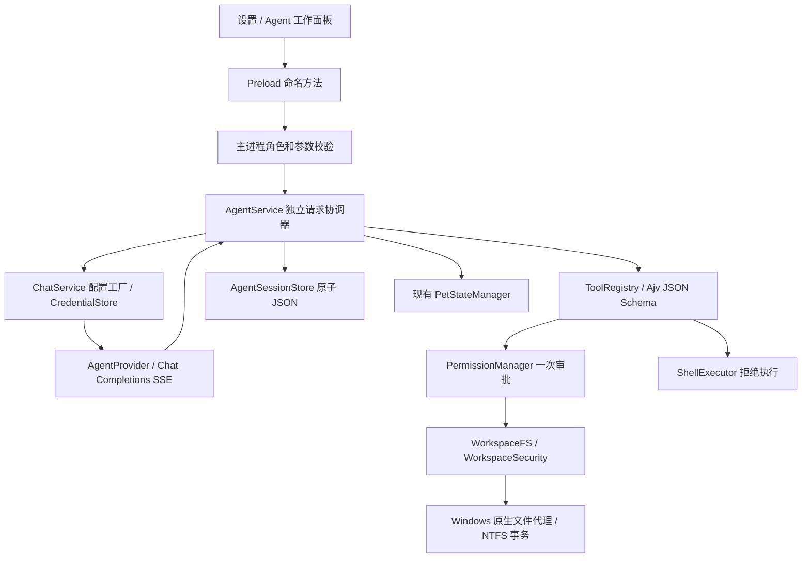

# 第三阶段 · 0.3.0

> 3.1 文件系统加固基于 `df33a19`。当前文件工具的实现、测试和支持范围见文末「3.1 原生文件代理」。

基线 main / 096a478。沿用第二阶段聊天、安全 IPC 和动画系统。新增 JSON Schema 校验依赖 Ajv 8.20.0，没有 SDK、数据库或 Agent 平台依赖。

## 当前交付范围

可用：独立 Agent 请求循环、SSE tool_calls 拼接、原生工作区选择、文件工具、一次性审批、计划、流式可见回复、工具记录、文件前后内容、任务切换、停止及手动继续。

**不可用：Shell、Git 命令、构建、测试、其他代码执行和网络工具。Windows sandbox 实测未通过，Shell 执行器拒绝调用。3.2 起 `request_network` 直接拒绝。**

## 架构



ChatService 的普通聊天协调与 Agent 分离。Agent 每次启动获取主进程内 Provider 配置和 Key 快照；凭据不传给 Renderer。工作区由设置窗口调用原生 dialog，IPC 不接收自选路径。任务持有固定 root，活动期间切换被拒绝；继续历史任务需重新选择该任务原目录。

模型第一轮必须返回 tool_calls，否则明确失败；不静默降级。最多 24 轮、每轮最多 16 个工具、任务限时 10 分钟。片段按 index 组合 id/name/arguments，结束后经 JSON Schema 校验及文件业务检查。写操作串行。只展示模型公开回复，不展示隐藏推理。每轮保留实际 usage；缺失用量不估算。

## 0.3.0 文件边界与限制（历史记录）

- 逐段 lstat 与 native realpath 核对路径，拒绝符号链接、Junction、特殊文件以及路径重定向；写入还需 path.relative 组件边界校验，禁止根目录操作。
- 拒绝 UNC、设备路径、ADS、盘符相对路径、尾部空格/点、保留设备名及超过 240 字符的路径；不以支持这些路径为由扩大权限。
- 外部绝对路径允许读取和搜索；移动源/目标均须在工作区，复制只允许目标在工作区。应用 userData 目录禁止访问，工作区不能包含该目录。
- 写入同目录随机临时文件，wx 独占创建、fsync 后 rename；不原地截断原文件。硬链接覆盖被拒绝；删除/移动也拒绝普通文件硬链接。递归遍历遇链接失败，不跟随它删除。
- 文本单文件 512 KiB，递归深度 12、2000 项，搜索/目录复制读取 8 MiB、搜索结果 100 条。复制支持 UTF-8 文本文件/目录，不支持二进制内容。apply_patch 为唯一旧文本替换，旧文本不匹配不写入。
- 文件 Diff UI 是完整 before/after 内容对照，不是行级统一 diff。目录移动和删除记录路径/目录标记；多文件操作不是事务，失败可能已完成部分项，逐项写入记录保留。

**安全限制：当前文件工具是同步 Node 主进程校验，不是 Windows 原生目录句柄锁定的文件代理。检查和操作之间仍存在恶意本地进程并发替换目录的 TOCTOU 风险；未知 reparse tag、竞态及完整 Windows 文件系统攻击矩阵未验证。不能宣称达到“任意本地对手下绝对无外部修改”的安全认证。** 在需要该级别保证的环境，应完成原生句柄代理并进行竞态测试后再部署写工具。本次边界测试证明的是预置链接和工具参数攻击被拒绝。

## Windows sandbox 实测

实际二进制版本 `codex-cli 0.128.0`。检查了 `codex sandbox --help` 和 `codex sandbox windows --help`。该版本要求显式 `--permissions-profile`；旧 sandbox_mode 参数并不能直接满足入口要求。使用以下命名配置进行诊断：

```text
codex sandbox windows --permissions-profile emma-stage3 -C <fixture-workspace>
-c service_tier=fast
-c permissions.emma-stage3.filesystem.:root=read
-c permissions.emma-stage3.filesystem.:project_roots=write
-c permissions.emma-stage3.network.enabled=false
-- powershell.exe -NoProfile -NonInteractive -ExecutionPolicy Bypass -File <fixture-script>
```

诊断使用受限环境变量白名单，TEMP/TMP 指向工作区，无 API Key。测试只操作 `.test-build` 内专用夹具及本机 HTTP 探测端点。`scripts/sandbox-probe.mjs <absolute-codex.exe>` 检查精确版本并将报告写入独立 fixture，不给产品授权。

2026-11-13 实测结果：

| 探测 | 结果 |
|---|---|
| 工作区内创建、修改、删除 | 成功 |
| 工作区外创建、修改 | 被拒绝 |
| 工作区外删除 | **成功，安全失败** |
| loopback HTTP | **可访问，安全失败** |
| HKCU 测试键创建 | 被拒绝 |
| Python/Node/CMD、链接组合、服务、完整进程树 | 未验收 |

基础拒绝项失败后没有启用命令执行；不能用这些局部通过项宣称沙箱合格。官方 Windows 文档仅用于评估入口，实际结果以本机探测为准：[Windows sandbox](https://developers.openai.com/codex/windows)。未修改用户现有 Codex 配置。

## 记录、审批和恢复

userData 新增 `workspace.json`、`agent-sessions.json`。任务文件保存用户指令、回复、工具参数及结果、计划、修改记录、审批、usage、状态，50 MiB 上限、100 任务上限。当前没有任务删除 UI，达到上限需后续增加归档功能。

工具执行前持久化 pending/running，完成后存 completed/failed；退出取消并标记 interrupted，重启将未终结工具标记 interrupted，不自动执行。继续任务重新推理，携带审计摘要，要求先检查现场；不会重发旧 tool_calls。取消会撤销待审批项，旧请求不能改变新请求动画。删除默认需要单次审批。工作区外写入在审批前直接拒绝。

## 修改文件

新增：`src/shared/agent.ts`；`src/main/agent/{AgentService,AgentProvider,ToolRegistry,WorkspaceFS,WorkspaceSecurity,ShellExecutor,AgentSessionStore,PermissionManager}.ts`；`src/renderer/Agent.tsx`；`tests/agent.test.ts`；`scripts/sandbox-probe.mjs`；本文件。

修改：`src/main/main.ts`、`src/main/chat/ChatService.ts`、`src/main/PetStateManager.ts`、`src/main/integrations/contracts.ts`；`src/shared/{types,channels}.ts`；`src/preload/preload.ts`；`src/renderer/{Panels.tsx,styles.css}`；`scripts/test.mjs`；`tests/{core.test.ts,electron-smoke.ts}`；`package.json`、`package-lock.json`、`.gitignore`；README、ARCHITECTURE、ACCEPTANCE。

## 启动和手动验收

1. 退出旧版托盘程序，`npm ci`、`npm start`。普通 build 不更新旧便携版。
2. 沿用已有 API 配置，在设置通过原生目录选择器选择专用测试目录。
3. 工作面板要求“制定计划，创建 hello.txt，读取并将 hello 改为 world”。确认审批前无写入，拒绝后模型收到拒绝结果。
4. 检查任务切换、流式回复、计划、工具结果、文件内容对照、usage 和动画；普通聊天可独立运行。
5. 中途停止、退出、重启，检查 interrupted、手动继续和实际文件，确认无自动重放；模型可能在新一轮提出新操作，仍受相同审批约束。
6. 要求外部写入必须拒绝；外部读取前理解内容会传给所配置模型。要求 Shell、Git 或网络时明确不可用，不得显示执行成功。
7. 真实模型 tool calling、较长响应、原生对话框及所有 UI 交互仍需人工联调。本阶段未发送真实付费 API 请求。

核心自动测试覆盖预置 Junction/硬链接、路径越界与 ADS、补丁不匹配保留原文件、JSON Schema、工具片段、required 不支持、审批、取消与恢复。完整安全验收未通过，不能以类型检查或模拟测试替代。

本次执行结果：TypeScript 类型检查通过；Vite/Electron 构建通过；20 组核心测试全部通过（保留第二阶段 15 组，新增 5 组）；Electron 窗口与真实进程重启检查通过，包含新增 Agent IPC 角色拒绝。已检查工作面板截图，完整真实模型任务和交互仍待手动验收。新增 Ajv 固定为 8.20.0，安装审计报告 0 个已知漏洞。

## 3.1 原生文件代理（2026-11-20）

### 机制与构建

新增 `native/WorkspaceProxy.cs`，使用 Windows 自带 .NET Framework 4.x C# 编译器构建 x64 独立 helper，无第三方原生依赖，无 Rust 工具链或 Electron ABI 绑定。通过 P/Invoke 使用 NtCreateFile、NtSetInformationFile 和句柄信息查询。`scripts/native.mjs` 在 build/test 时编译到 `dist/native/Emma.WorkspaceProxy.exe`；现有 package 脚本复制整个 dist，因此便携构建包含 helper。生产程序不动态编译、不执行模型命令，没有 Node 文件操作后备。

`NativeWorkspaceProxy.ts` 只通过 stdin/stdout 交换单条有上限的 JSON，固定 executable 路径，windowsHide=true，只传 SystemRoot/WINDIR 环境变量；不传 API Key、命令行文件内容或 Shell。单次代理 30 秒超时、4 MiB 输出上限。Windows x64、固定本地 NTFS 之外直接拒绝。Windows 10/11 仍需各目标版本测试；本机实测为 Windows 11 build 26300。

WorkspaceFS 的读、遍历、创建、补丁、复制、移动和删除全部委托 helper，Node WorkspaceSecurity 只负责审批前参数提示与保存工作区身份。helper 每次重新执行边界校验，不信任 Node 的预检结果。

### 路径与句柄

1. 仅接受规范化的本地盘符路径，拒绝 UNC、设备命名空间、ADS、保留名、尾部点/空格、控制符和超过 240 字符的路径。
2. 从卷根开始逐个单路径组件调用 NtCreateFile，RootDirectory 指向已经打开的父目录，使用 FILE_OPEN_REPARSE_POINT 打开对象本身。检查 FILE_ATTRIBUTE_REPARSE_POINT，所有 tag 均拒绝，不只识别 symlink/Junction。
3. GetFinalPathNameByHandle 校对句柄实际名称，拒绝 8.3 别名、SUBST 等重定向。拒绝启用了大小写敏感语义的目录，避免字符串边界和 NTFS 语义不一致。
4. 保存卷序列号和 FileIndex 作为工作区身份。同一 WorkspaceSecurity 生命周期内每次操作重新验证，根目录被替换后拒绝。目录枚举返回的 File ID 与随后打开的句柄 ID 比较。禁止在工作区外写入、操作工作区根目录，以及访问应用数据和文件代理所在目录。
5. 持有路径祖先目录句柄至操作结束，禁止删除共享，阻止改名和置换。需要完整路径的 TxF 操作从已固定父目录的句柄取得实际卷 GUID 路径，再把直接父目录登记为事务写入者，核对卷序列号及文件 ID。事务写锁也排斥仅请求 `FILE_WRITE_ATTRIBUTES` 权限的句柄。更上层祖先仍含有已固定的下一级目录，NTFS 拒绝在非空目录上设置 Reparse Point。
6. 普通读取与移动源使用单组件相对句柄打开。多硬链接的普通文件一律拒绝。移动使用源句柄与目标父目录句柄，禁止替换已有目标。目录移动预检子树后释放子项句柄，以兼容 Windows 的移动约束，并保留源目录与祖先句柄。

参考微软原始 API 文档：[NtCreateFile](https://learn.microsoft.com/windows/win32/api/winternl/nf-winternl-ntcreatefile)、[FILE_RENAME_INFORMATION](https://learn.microsoft.com/windows-hardware/drivers/ddi/ntifs/ns-ntifs-_file_rename_information)。文档语义加本机实验支持此设计，但不构成所有 Windows 版本/文件系统的形式证明。

### 覆盖、目录事务与失败处理

覆盖、补丁、创建目录、复制和删除使用 Windows Kernel Transaction Manager 与 Transactional NTFS（TxF）。每个操作单独开启一个事务。覆盖通过 `CreateFileTransactedW` 打开单硬链接目标，校验对象后用同一文件句柄读取、写入、截断和刷新。新文件以 `CREATE_NEW` 创建。全程没有临时文件按名称覆盖目标的步骤。关闭写入句柄后，TxF 仍隔离事务内的修改并阻止竞争写入，直到提交或回滚。补丁在同一事务内完成读取与唯一匹配。

递归删除先校验并打开子树，再按照从子项到根的顺序通过事务句柄标记删除。打开目标时拒绝与已有数据读取句柄共享，以免删除被推迟。目录复制先读取完整且有上限的源树，再在同一事务中创建整个新目标。两种操作都在关闭事务文件句柄后统一提交，错误退出则请求回滚。代理在提交成功后才返回文件变更。程序在提交前被结束时，由 Windows 收回事务并回滚已暂存的更改。如果在提交过程中失去代理响应，调用方不能据此判断事务结果，应检查文件现状。任务恢复不会自动重放写操作。

复制和删除支持二进制文件。复制以字节读取，单文件和单次复制总计 8 MiB，删除的预览若非 UTF-8 显示字节数量。文本读写和补丁限 512 KiB，递归深度 12，遍历上限约 2000 项，搜索结果最多 100 项。复制只保留文件内容和目录结构，不复制 ACL、ADS、EFS 等元数据。

文件代理仅支持 Windows x64 上的固定本地 NTFS 卷。TxF 无法开启或拒绝当前对象时，相关操作直接失败，禁止回退到普通文件写入。EFS 文件不支持事务操作。微软不建议新系统依赖 TxF，并可能在将来的 Windows 版本移除相关 API。[TxF 使用方式](https://learn.microsoft.com/windows/win32/fileio/how-to-use-transactional-ntfs)、[隔离与锁](https://learn.microsoft.com/windows/win32/fileio/txf-basic-concepts)、[平台限制](https://learn.microsoft.com/windows/win32/api/winbase/nf-winbase-createfiletransactedw)。

### 实测与未覆盖范围

新增测试使用单独编译的 `WorkspaceProxy.Test.exe`，编译宏 TEST_HOOKS 在所有检查完成、真实内核操作前输出 barrier，Node 测试进程并发攻击后放行。发布 helper 不包含 barrier 或测试 fixture 创建入口。

- 正常文件创建、编辑、移动、删除；目录移动、递归复制和删除通过。
- 二进制外部文件复制入工作区后逐字节相同，删除不解码；外部内容保持不变。
- 预置 Junction、硬链接、越界/ADS/设备路径被拒绝。
- 成功创建真实非 Microsoft Reparse Tag `0x42` 夹具；读取、复制、删除及写入其子路径均拒绝，没有跳过测试。
- barrier 内尝试替换父目录和工作区根失败；删除、移动源替换失败；移动目标被并发创建时失败，源和新目标均完整。
- 在写入前以及关闭事务句柄后、提交前，尝试移走目标、换入外部硬链接及为目标创建外部链接，均被拒绝。预置硬链接的写入、复制覆盖、移动和删除均被拒绝。外部文件字节、文件 ID、链接计数、修改时间和元数据变更时间保持一致。
- 在创建文件或目录前以及提交前，尝试通过只申请 `FILE_WRITE_ATTRIBUTES` 的句柄将空父目录改成未知 Reparse Point，均被拒绝。
- 对单文件覆盖及目录复制、递归删除的每个暂存步骤注入失败，验证原有树的内容、文件身份、链接计数及修改时间保持一致，复制目标不存在。分别在中途及提交前强制终止代理，验证操作由系统回滚。存在数据读取句柄时拒绝递归删除，提交前外部可见的原目录保持完整。
- WorkspaceSecurity 创建后替换根目录，再次写入因身份不一致拒绝。
- 模拟 TxF 不可用，覆盖操作直接失败，原文件保持完整。
- 31 组核心测试全部通过，无跳过。TypeScript 检查、Vite/Electron 构建以及 Electron 桌宠窗口、IPC 限制和真实进程重启冒烟测试均通过。

未覆盖的情况包括其他 Windows 版本、Cloud Files 和第三方过滤驱动、管理员或内核级篡改、卷卸载重挂、文件 ID 回收、内存映射写入、真实断电与存储损坏。ReFS/FAT、网络卷、可移动卷、大小写敏感目录和长路径不在支持范围内。

上述结果限定于本机 Windows 11 build 26300 与固定本地 NTFS 卷。Shell 保持禁用。

新增文件：`native/WorkspaceProxy.cs`、`scripts/native.mjs`、`src/main/agent/NativeWorkspaceProxy.ts`。
修改文件：WorkspaceSecurity、WorkspaceFS、ToolRegistry 的复制说明、build/test/smoke 脚本、agent.test.ts 和本记录。AgentRuntime、审批协议及 UI 接口保持兼容。

## 3.1.1 异步代理与工作区绑定

主进程异步启动原生代理，单次请求最长运行 30 秒，输入最多 2 Mi UTF-16 代码单元，标准输出最多 4 MiB，标准错误最多 64 KiB，标准错误内容不保留。取消、超时或输出超限时终止代理，并等待进程及管道关闭。操作明确成功后才记录文件变更。取消或无法确定结果的工具记录为 `interrupted`，任务停止当前执行轮次，恢复时不重放旧调用。文件提交与收到结果之间仍可能发生中断，手动继续前须先核对文件现状。

原生选择器确认后，将代理返回的卷序列号和目录 File ID 写入 `workspace.json` 的 `identity`。每个任务保存自己的 `rootIdentity`。启动和手动继续前重新验证绑定，随后每次文件操作仍由代理核对身份。旧配置需在设置重新选择目录，旧任务缺少身份时只允许查看。窗口读取启动时异步验证的缓存状态，并通过独立的工作区事件更新。任务快照与流式输出不会触发工作区查询。

## 3.2 工具权限中心

`workspace.json` 版本 2 保存 `root`、`identity` 和 `permissionsByIdentity`。每个目录身份对应一份工具权限表。切换到未配置的工作区使用默认值，切回原身份恢复原权限。损坏的权限表整份回退到默认值。

旧 `autoWrite` 在目录身份已保存时迁移。`true` 将除删除外的修改工具设为 `allow`，`false` 将它们设为 `ask`。删除和外部读取均为 `ask`，五种读取工具均为 `allow`。没有已记录身份的旧配置须重新选择工作区，使用默认权限。

主进程在 JSON Schema 校验后解析实际路径，合并工具权限和外部读取权限。`copy_path` 还检查 `read_file`，工作区外的复制源再检查 `external_read`。任一检查为 `deny` 则拒绝，任一检查为 `ask` 则为本次操作生成一张审批卡。批准只适用于卡片上的路径和操作，执行前仍检查权限是否已改为禁止。无明确设置时，五种读取工具为 `allow`，七种修改工具及 `external_read` 为 `ask`。

只有设置窗口能通过 IPC 更新单项权限，设置与工作面板接收同一工作区状态。`update_plan` 仅在内存中更新任务计划并随任务保存。Shell 和网络工具始终拒绝执行。工作区外写入不可审批，原生代理仍检查物理文件边界、目录身份与事务条件。
