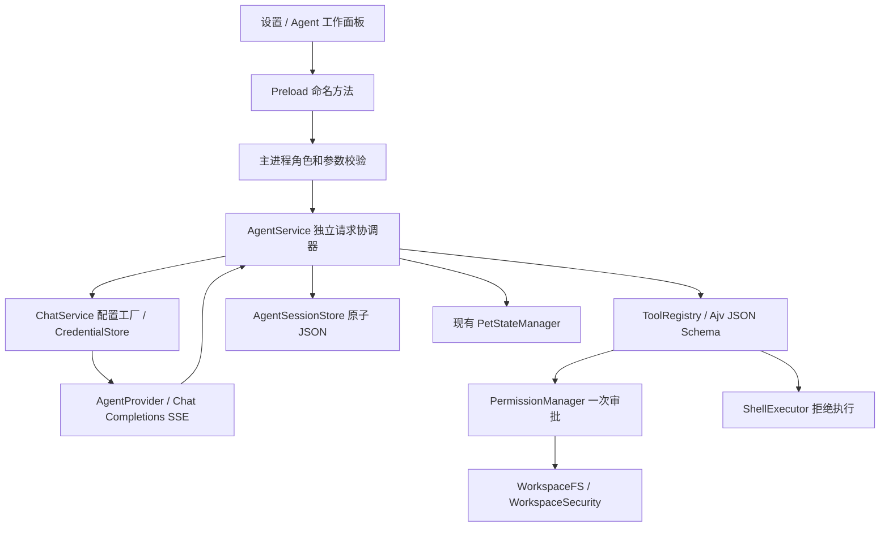

# 第三阶段 · 0.3.0

基线 main / 096a478。沿用第二阶段聊天、安全 IPC 和动画系统。新增 JSON Schema 校验依赖 Ajv 8.20.0，没有 SDK、数据库或 Agent 平台依赖。

## 当前交付范围

可用：独立 Agent 请求循环、SSE tool_calls 拼接、原生工作区选择、文件工具、一次性审批、计划、流式可见回复、工具记录、文件前后内容、任务切换、停止及手动继续。

**不可用：Shell、Git 命令、构建、测试和其他代码执行。Windows sandbox 实测未通过，执行器硬性拒绝调用，无普通进程 fallback。网络审批只记录本次决定，不启用任何网络执行后端。** 因此本版不是具备完整终端能力的 Codex 替代品。

## 架构



ChatService 的普通聊天协调与 Agent 分离。Agent 每次启动获取主进程内 Provider 配置和 Key 快照；凭据不传给 Renderer。工作区由设置窗口调用原生 dialog，IPC 不接收自选路径。任务持有固定 root，活动期间切换被拒绝；继续历史任务需重新选择该任务原目录。

模型第一轮必须返回 tool_calls，否则明确失败；不静默降级。最多 24 轮、每轮最多 16 个工具、任务限时 10 分钟。片段按 index 组合 id/name/arguments，结束后经 JSON Schema 校验及文件业务检查。写操作串行。只展示模型公开回复，不展示隐藏推理。每轮保留实际 usage；缺失用量不估算。

## 文件边界与限制

- 逐段 lstat 与 native realpath 核对路径，拒绝符号链接、Junction、特殊文件以及路径重定向；写入还需 path.relative 组件边界校验，禁止根目录操作。
- 拒绝 UNC、设备路径、ADS、盘符相对路径、尾部空格/点、保留设备名及超过 240 字符的路径；不以支持这些路径为由扩大权限。
- 外部绝对路径允许读取和搜索；移动源/目标均须在工作区，复制只允许目标在工作区。应用 userData 目录禁止访问，工作区不能包含该目录。
- 写入同目录随机临时文件，wx 独占创建、fsync 后 rename；不原地截断原文件。硬链接覆盖被拒绝；删除/移动也拒绝普通文件硬链接。递归遍历遇链接失败，不跟随它删除。
- 文本单文件 512 KiB，递归深度 12、2000 项，搜索/目录复制读取 8 MiB、搜索结果 100 条。复制支持 UTF-8 文本文件/目录，不支持二进制内容。apply_patch 为唯一旧文本替换，旧文本不匹配不写入。
- 文件 Diff UI 是完整 before/after 内容对照，不是行级统一 diff。目录移动和删除记录路径/目录标记；多文件操作不是事务，失败可能已完成部分项，逐项写入记录保留。

**安全限制：当前文件工具是同步 Node 主进程校验，不是 Windows 原生目录句柄锁定的文件代理。检查和操作之间仍存在恶意本地进程并发替换目录的 TOCTOU 风险；未知 reparse tag、竞态及完整 Windows 文件系统攻击矩阵未验证。不能宣称达到“任意本地对手下绝对无外部修改”的安全认证。** 在需要该级别保证的环境，应完成原生句柄代理并进行竞态测试后再部署写工具。本次边界测试证明的是预置链接和工具参数攻击被拒绝。

## Windows sandbox 实测

实际二进制版本 `codex-cli 0.128.0`。检查了 `codex sandbox --help` 和 `codex sandbox windows --help`。该版本要求显式 `--permissions-profile`；旧 sandbox_mode 参数并不能直接满足入口要求。使用以下命名配置进行诊断：

```text
codex sandbox windows --permissions-profile emma-stage3 -C <fixture-workspace>
-c service_tier=fast
-c permissions.emma-stage3.filesystem.:root=read
-c permissions.emma-stage3.filesystem.:project_roots=write
-c permissions.emma-stage3.network.enabled=false
-- powershell.exe -NoProfile -NonInteractive -ExecutionPolicy Bypass -File <fixture-script>
```

诊断使用受限环境变量白名单，TEMP/TMP 指向工作区，无 API Key。测试只操作 `.test-build` 内专用夹具及本机 HTTP 探测端点。`scripts/sandbox-probe.mjs <absolute-codex.exe>` 检查精确版本并将报告写入独立 fixture，不给产品授权。

2026-11-13 实测结果：

| 探测 | 结果 |
|---|---|
| 工作区内创建、修改、删除 | 成功 |
| 工作区外创建、修改 | 被拒绝 |
| 工作区外删除 | **成功，安全失败** |
| loopback HTTP | **可访问，安全失败** |
| HKCU 测试键创建 | 被拒绝 |
| Python/Node/CMD、链接组合、服务、完整进程树 | 未验收 |

基础拒绝项失败后没有启用命令执行；不能用这些局部通过项宣称沙箱合格。官方 Windows 文档仅用于评估入口，实际结果以本机探测为准：[Windows sandbox](https://developers.openai.com/codex/windows)。未修改用户现有 Codex 配置。

## 记录、审批和恢复

userData 新增 `workspace.json`、`agent-sessions.json`。任务文件保存用户指令、回复、工具参数及结果、计划、修改记录、审批、usage、状态，50 MiB 上限、100 任务上限。当前没有任务删除 UI，达到上限需后续增加归档功能。

工具执行前持久化 pending/running，完成后存 completed/failed；退出取消并标记 interrupted，重启将未终结工具标记 interrupted，不自动执行。继续任务重新推理，携带审计摘要，要求先检查现场；不会重发旧 tool_calls。取消会撤销待审批项，旧请求不能改变新请求动画。删除总需单次审批；工作区外写入在审批前直接拒绝。审批不会改变文件边界。

## 修改文件

新增：`src/shared/agent.ts`；`src/main/agent/{AgentService,AgentProvider,ToolRegistry,WorkspaceFS,WorkspaceSecurity,ShellExecutor,AgentSessionStore,PermissionManager}.ts`；`src/renderer/Agent.tsx`；`tests/agent.test.ts`；`scripts/sandbox-probe.mjs`；本文件。

修改：`src/main/main.ts`、`src/main/chat/ChatService.ts`、`src/main/PetStateManager.ts`、`src/main/integrations/contracts.ts`；`src/shared/{types,channels}.ts`；`src/preload/preload.ts`；`src/renderer/{Panels.tsx,styles.css}`；`scripts/test.mjs`；`tests/{core.test.ts,electron-smoke.ts}`；`package.json`、`package-lock.json`、`.gitignore`；README、ARCHITECTURE、ACCEPTANCE。

## 启动和手动验收

1. 退出旧版托盘程序，`npm ci`、`npm start`。普通 build 不更新旧便携版。
2. 沿用已有 API 配置，在设置通过原生目录选择器选择专用测试目录。
3. 工作面板要求“制定计划，创建 hello.txt，读取并将 hello 改为 world”。确认审批前无写入，拒绝后模型收到拒绝结果。
4. 检查任务切换、流式回复、计划、工具结果、文件内容对照、usage 和动画；普通聊天可独立运行。
5. 中途停止、退出、重启，检查 interrupted、手动继续和实际文件，确认无自动重放；模型可能在新一轮提出新操作，仍受相同审批约束。
6. 要求外部写入必须拒绝；外部读取前理解内容会传给所配置模型。要求 Shell、Git 或网络时明确不可用，不得显示执行成功。
7. 真实模型 tool calling、较长响应、原生对话框及所有 UI 交互仍需人工联调。本阶段未发送真实付费 API 请求。

核心自动测试覆盖预置 Junction/硬链接、路径越界与 ADS、补丁不匹配保留原文件、JSON Schema、工具片段、required 不支持、审批、取消与恢复。完整安全验收未通过，不能以类型检查或模拟测试替代。

本次执行结果：TypeScript 类型检查通过；Vite/Electron 构建通过；20 组核心测试全部通过（保留第二阶段 15 组，新增 5 组）；Electron 窗口与真实进程重启检查通过，包含新增 Agent IPC 角色拒绝。已检查工作面板截图，完整真实模型任务和交互仍待手动验收。新增 Ajv 固定为 8.20.0，安装审计报告 0 个已知漏洞。
